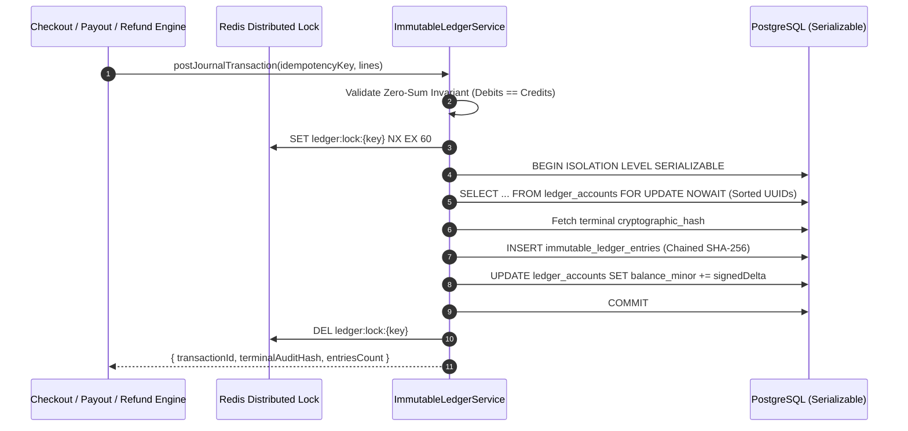

# Enterprise Immutable Ledger Engine

[](https://github.com/ValelethiaJohnson/enterprise-ledger-engine/actions)
[](https://opensource.org/licenses/Apache-2.0)
[](https://www.typescriptlang.org/)
[](https://www.postgresql.org/)

An enterprise-grade, append-only **Double-Entry Bookkeeping & Financial Ledger Engine** engineered for high-concurrency payment infrastructures. It enforces strict mathematical zero-sum invariants, deadlock-free pessimistic row-level locking, and tamper-evident SHA-256 cryptographic audit trails.

---

## 🏛️ Core Architectural Guarantees

1. **Zero-Sum Double-Entry Invariant:** Every financial mutation requires at least two balanced journal legs where $\sum \text{Debits} = \sum \text{Credits}$ in integer minor units (`BigInt`). Unbalanced entries are deterministically rejected prior to database I/O.
2. **Deadlock-Free Pessimistic Concurrency:** Accounts participating in a multi-leg journal transaction are lexicographically sorted by UUID and locked via PostgreSQL `SELECT ... FOR UPDATE NOWAIT` inside a strict `Serializable` transaction boundary.
3. **Tamper-Evident Cryptographic Hash Chaining:** Each ledger entry computes a deterministic `SHA-256` digest linking its transaction payload to the `previous_hash` of the preceding entry, forming an immutable, verifiable cryptographic audit trail.
4. **Distributed Idempotency Protection:** Redis `SET NX EX` distributed locks combined with unique composite idempotency keys guarantee exactly-once ledger posting across retries.

---

## 🔄 Transaction Execution Lifecycle



---

## 📂 Repository Structure

```text
enterprise-ledger-engine/
├── .github/workflows/
│   └── ci.yml                  # Automated build, Prisma & Vitest verification
├── prisma/
│   └── schema.prisma           # Immutable ledger & account relational schema
├── src/
│   └── services/
│       └── ledger.service.ts   # Core double-entry & SHA-256 chaining engine
├── tests/
│   └── invariants/
│       └── ledger.spec.ts      # Zero-sum & cryptographic invariant test suite
├── .env.example                # Environment configuration template
├── docker-compose.yml          # PostgreSQL 16 & Redis 7 local orchestration
├── package.json                # Dependencies & verification scripts
└── tsconfig.json               # Strict TypeScript compiler configuration
```

---

## 🚀 Quick Start & Local Verification

```bash
# 1. Provision isolated PostgreSQL 16 and Redis 7 containers
docker compose up -d

# 2. Install dependencies and generate Prisma Client
npm install
npm run db:generate

# 3. Verify strict TypeScript compilation
npm run typecheck

# 4. Execute Zero-Sum & Cryptographic Invariant Test Suite
npm run test:invariants
```

---

## 📄 License

Licensed under the **Apache License, Version 2.0**. See [LICENSE](LICENSE) for full details.

