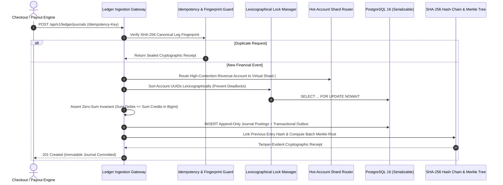

# Enterprise Immutable Ledger Engine


An enterprise-grade, append-only **Double-Entry Bookkeeping & Financial Ledger Engine** engineered for high-concurrency payment infrastructures. It enforces strict mathematical zero-sum invariants, deadlock-free pessimistic row-level locking, virtual hot-account sharding, and tamper-evident `SHA-256` cryptographic audit trails.

---

## 📊 Immutable Double-Entry Posting & Cryptographic Sealing Flow



---

## 🏛️ Core Financial Ledger Architectural Matrix

| Accounting & Systems Domain | Source Implementation | Mathematical Invariant & Engineering Guarantee |
| :--- | :--- | :--- |
| **Zero-Sum Double-Entry Core** | `src/services/` | Enforces $\sum \text{Debits} - \sum \text{Credits} = 0$ in `BigInt` minor units across multi-legged split settlements. |
| **Lexicographical Lock Manager** | `src/concurrency/lock-manager.ts` | Deduplicates and sorts participating account UUIDs canonically prior to `FOR UPDATE NOWAIT`, eliminating circular-wait deadlocks. |
| **Hot-Account Virtual Sharding** | `src/sharding/hot-account-sharding.ts` | Eliminates contention on central fee/clearing accounts by distributing writes across $16$ deterministic `SHA-256` shards. |
| **Two-Phase Escrow (Hold/Capture)** | `src/escrow/hold-capture-engine.ts` | Manages pre-authorization funds across `AVAILABLE`, `ENCUMBERED`, and `SETTLED` compartments with partial capture support. |
| **Cryptographic Hash Chain** | `src/audit/hash-chain-verifier.ts` | Links every journal entry to its predecessor's `SHA-256` digest, forming an immutable, verifiable ledger chain. |
| **Merkle Tree Batch Sealer** | `src/audit/merkle-tree.ts` | Computes domain-separated `SHA-256` Merkle roots across settlement batches for external SOX/PCI-DSS auditing. |
| **3-Way Settlement Reconciliation** | `src/reconciliation/psp-settlement-matcher.ts` | Cross-verifies internal ledger balances against Stripe settlement reports and bank wire statements to single-cent precision. |
| **Mark-to-Market FX Revaluation** | `src/fx/multi-currency-revaluation.ts` | Computes unrealized foreign exchange gains and losses across multi-currency treasury positions. |
| **End-of-Day (EOD) Trial Balance** | `src/closing/eod-trial-balance.ts` | Generates daily cut-off certificates proving global debit/credit conservation across all Chart of Accounts buckets. |
| **Point-in-Time Balance Snapshots** | `src/snapshot/snapshot-service.ts` | Sequence-checkpointed balance folding delivering sub-millisecond balance inquiries without full table scans. |
| **Append-Only Reversal Engine** | `src/services/reversal-service.ts` | Generates exact compensating journal postings to invert erroneous or refunded transactions without mutating rows. |
| **Transactional Outbox & SOX Guard** | `src/outbox/` & `src/compliance/` | Atomic Kafka event emission paired with automated PII redaction and PostgreSQL serialization circuit breaking. |

---

## 📂 Repository Topology & Production Infrastructure

```text
enterprise-ledger-engine/
├── .github/                  # CI Pipeline, Dependabot, CODEOWNERS, FUNDING & PR Gates
├── chaos/                    # Chaos Mesh PostgreSQL WAL I/O Latency & Split-Brain Partitioning
├── docs/adr/                 # Architectural Decision Records (ADR-0001 to ADR-0003)
├── k8s/                      # Zero-Downtime Deployment, HPA Autoscaling & Zero-Trust NetworkPolicy
├── load-tests/               # TypeScript High-Concurrency Flash-Sale Throughput Benchmark
├── prisma/                   # Append-Only Double-Entry PostgreSQL 16 Schema
├── src/
│   ├── audit/                # SHA-256 Merkle Tree Sealer & Sequential Hash-Chain Verifier
│   ├── circuit-breaker/      # PostgreSQL Serialization Conflict Overload Guard
│   ├── closing/              # End-of-Day (EOD) Trial Balance Generator & Cut-Off Engine
│   ├── compliance/           # SOX & PCI-DSS PII Audit Metadata Scrubber
│   ├── concurrency/          # Deadlock-Free Lexicographical Account Lock Manager
│   ├── escrow/               # Two-Phase Funds Hold, Partial Capture & Release Engine
│   ├── fx/                   # Multi-Currency Mark-to-Market Unrealized FX Revaluation
│   ├── idempotency/          # Canonical Journal Leg Fingerprinting & Replay Protection
│   ├── outbox/               # Transactional Outbox Envelope Factory for Kafka Streaming
│   ├── reconciliation/       # Automated 3-Way Ledger, PSP & Bank Settlement Matcher
│   ├── services/             # Core Double-Entry Ingestion & Compensating Reversal Engine
│   ├── sharding/             # Deterministic Virtual Sharding for High-Contention Accounts
│   ├── snapshot/             # Sequence-Aware Point-in-Time Account Balance Checkpointing
│   ├── telemetry/            # OpenTelemetry Distributed Tracing Span Instrumentation
│   └── types/                # Five-Pillar Chart of Accounts (Asset, Liability, Equity, Revenue, Expense)
├── tests/                    # Vitest Invariant, Concurrency, Sharding, Escrow & Audit Suites
├── Dockerfile                # Multi-Stage Hardened Non-Root Alpine Production Container
├── Makefile                  # Unified Architect Command Orchestration
└── openapi.yaml              # Formal OpenAPI 3.1.0 Machine-Readable Gateway Contract
```

---

## 📑 Architectural Decision Records (ADRs) & Governance

* **[ADR-0001: Append-Only Immutable Records & Merkle Sealing](docs/adr/0001-immutable-audit-records.md)** — Enforcing zero-update persistence and cryptographic batch sealing.
* **[ADR-0002: Deterministic Virtual Sharding for Hot Accounts](docs/adr/0002-hot-account-sharding.md)** — Partitioning central revenue accounts into 16 shards to eliminate lock contention.
* **[ADR-0003: Deadlock Elimination via Lexicographical Lock Ordering](docs/adr/0003-lexicographical-lock-ordering.md)** — Breaking circular wait conditions during concurrent transfers.
* **Operational Governance:** See [ARCHITECTURE.md](ARCHITECTURE.md), [API.md](API.md), [RUNBOOK.md](RUNBOOK.md), [SECURITY.md](SECURITY.md), and [CHANGELOG.md](CHANGELOG.md).

---

## ⚡ Quick Start & Invariant Verification

```bash
# 1. Install deterministic dependencies
make install

# 2. Run strict TypeScript compiler and ESLint verification
make typecheck && make lint

# 3. Execute zero-sum invariant, sharding, escrow, and cryptographic test suites
make test
```

---

## 💖 Sponsor This Project

If you find this enterprise-grade FinTech architecture valuable, consider supporting the development and maintenance of high-concurrency open-source financial systems.

[](https://github.com/sponsors/ValelethiaJohnson)
